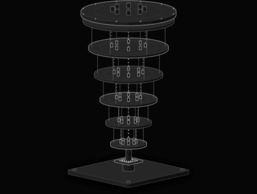
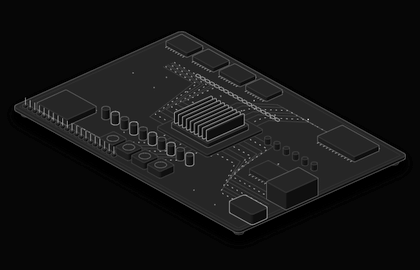
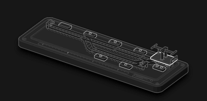
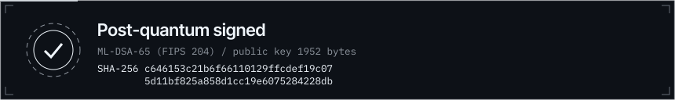

<p align="center">
  
</p>

<p align="center">
  
</p>

<p align="center">
<a href="https://www.mrgovind.com"></a>
<a href="https://linkedin.com/in/mr-govind-dubey"></a>
<a href="mailto:Govinddubeycse@gmail.com"></a>

</p>

I'm a cybersecurity professional working on what comes after today's cryptography: post-quantum systems, AI and IoT, alongside development and open source.

## Focus

<table>
<tr>
<td width="50%" valign="top">

**Quantum**



Post-quantum cryptography and the migration to it: lattice schemes, ML-KEM, ML-DSA and hybrid key exchange.

</td>
<td width="50%" valign="top">

**Cybersecurity**


Attacking systems to learn how to defend them: penetration testing, malware behaviour and detection.

</td>
</tr>
<tr>
<td width="50%" valign="top">

**Circuits**



IoT and connected hardware: securing constrained devices, where every byte of a key has a cost.

</td>
<td width="50%" valign="top">

**Developers**



Building software and AI tools, with local-first models and open source contributions.

</td>
</tr>
</table>

## GitHub activity


 

<p align="center"></p>


## The problem I care about

Traffic recorded today can be decrypted by a quantum computer later, so key exchange has to change before that computer exists. This is the hybrid TLS 1.3 handshake that closes the gap:



## Stack

        

## This page is signed



[](https://github.com/MrGovindDubey/MrGovindDubey/actions/workflows/verify.yml)

<details>
<summary>Verify it yourself</summary>

```sh
git clone https://github.com/MrGovindDubey/MrGovindDubey && cd MrGovindDubey/tools
npm ci --ignore-scripts && node verify.mjs
```

```text
key fingerprint (SHA-256): c646153c21b6f66110129ffcdef19c075d11bf825a858d1cc19e6075284228db
```

The signature covers `README.md` only, not the images. It proves the text is unchanged since the key holder signed it. The key stays offline; CI re-verifies on every push.

</details>

<sub>Built with [Gitly](https://gitlyy.vercel.app), [GitSkins](https://www.gitskins.com), [Anatomy](https://github.com/wheresryan22/anatomy), [readme-typing-svg](https://github.com/DenverCoder1/readme-typing-svg), [streak-stats](https://github.com/DenverCoder1/github-readme-streak-stats) and [shields.io](https://shields.io).</sub>
