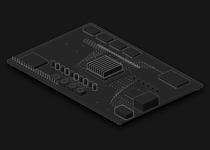
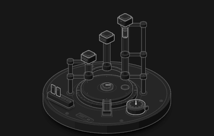
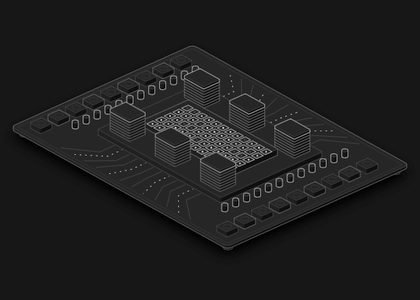
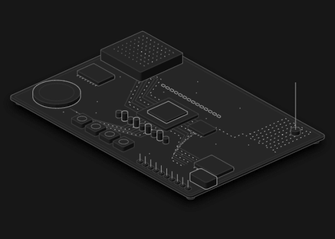
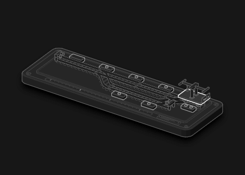
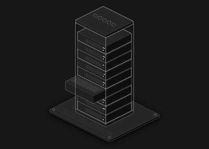

<p align="center">
  
</p>

<p align="center">
  
</p>

<p align="center">
<a href="https://www.mrgovind.com"></a>
<a href="https://linkedin.com/in/mr-govind-dubey"></a>
<a href="mailto:Govinddubeycse@gmail.com"></a>
<a href="https://pqblocks.github.io"></a>
</p>

<p align="center">
  
  
</p>

I'm a cybersecurity professional working on post-quantum cryptography, Gen AI, IoT, development and Linux.

## Focus

<table>
<tr>
<td width="33%" valign="top">

**Post-Quantum**



ML-KEM, ML-DSA, hybrid key exchange and the migration to them.

</td>
<td width="33%" valign="top">

**Cybersecurity**



Penetration testing, malware behaviour and detection.

</td>
<td width="33%" valign="top">

**Gen AI**



Local-first models, agents and explainable detection.

</td>
</tr>
<tr>
<td width="33%" valign="top">

**IoT**



Securing connected, constrained devices.

</td>
<td width="33%" valign="top">

**Development**



Building software and contributing to open source.

</td>
<td width="33%" valign="top">

**Linux**



KDE Plasma widgets, shell tooling and systems work.

</td>
</tr>
</table>

## GitHub activity


<p align="center">
  
  
  
  
  
</p>

<p align="center">
  
</p>


## Stack

<p align="center">
  
</p>

**Languages**

          

**AI and data**

       

**Web and backend**

        

**Security and crypto**

    

**Platforms and tools**

          

## PQBlocks

<a href="https://pqblocks.github.io"></a>

[](https://github.com/MrGovindDubey/MrGovindDubey/actions/workflows/verify.yml)

<details>
<summary>This README is signed with ML-DSA-65. Verify it yourself</summary>

```sh
git clone https://github.com/MrGovindDubey/MrGovindDubey && cd MrGovindDubey/tools
npm ci --ignore-scripts && node verify.mjs
```

```text
key fingerprint (SHA-256): c646153c21b6f66110129ffcdef19c075d11bf825a858d1cc19e6075284228db
```

The signature covers `README.md` only, not the images. It proves the text is unchanged since the key holder signed it. The key stays offline; CI re-verifies on every push.

</details>

